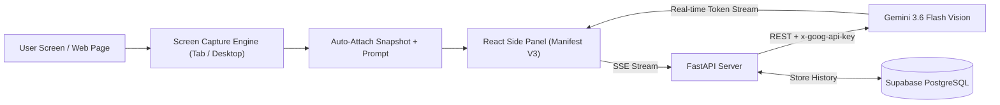

# 🚀 Personal AI Assistant - Screen-Aware Chrome Extension

An intelligent, vision-enabled AI companion built into Google Chrome's native Side Panel. The assistant can "see" your active browser tab or entire desktop in real-time, helping you diagnose coding bugs, debug terminal errors, summarize articles, inspect UI/UX designs, and answer questions grounded strictly in what's on your screen.

Powered by **React (Manifest V3)**, **FastAPI**, **Google Gemini 3.6 Vision**, and **Supabase (PostgreSQL)**.

---

## 📸 Overview & Workflow



---

## ✨ Features

- **👁️ Real-Time Screen Vision**:
  - **Auto-Capture on Send**: Automatically grabs a high-resolution snapshot of your active browser tab the moment you ask a question.
  - **Capture Desktop / External Apps**: Share your entire display or external IDEs (VS Code, PyCharm, terminal) with 1 click.
  - **Visual Verification**: Displays a thumbnail of the exact screen snapshot sent to the model.
- **⚡ Chrome Manifest V3 Side Panel**:
  - Built using Chrome's native `chrome.sidePanel` API.
  - Sits neatly alongside your tabs and external editors without obscuring your workspace.
- **🧠 Google Gemini Vision Engine**:
  - Uses the latest **`gemini-3.6-flash`** (with model switching for `gemini-1.5-flash` / `gemini-1.5-pro`).
  - Supports both legacy `AIza...` API keys and the newest `AQ...` authentication keys via official HTTP headers.
- **🛡️ Anti-Hallucination Grounding**:
  - Strict system prompt constraints ensure the assistant reads *only* what is visibly present on your screen, avoiding fabricated errors or hypothetical code.
- **💻 Developer-Friendly Chat Interface**:
  - Real-time Server-Sent Events (SSE) streaming.
  - Formatted Markdown with code syntax highlighting and **1-click Copy Code** buttons.
- **🗄️ Cloud Persistence with Supabase**:
  - Stores conversation sessions, user prompts, assistant answers, and metadata in PostgreSQL.

---

## 🛠️ Tech Stack

| Layer | Technology | Purpose |
| :--- | :--- | :--- |
| **Frontend** | React 18, Vite, Lucide Icons, React Markdown | Fast, modern Chrome Extension Side Panel UI |
| **Extension Standard**| Manifest V3 (Chrome Side Panel API) | Secure background service workers & tab capture |
| **Backend** | FastAPI, Uvicorn, Python 3.10+ | High-performance async REST API with SSE streaming |
| **AI Model** | Google Gemini 3.6 Flash / 1.5 Flash Vision | Multimodal visual reasoning and coding assistance |
| **Database** | Supabase (PostgreSQL) | Persistent storage for chat threads and messages |

---

## 📁 Project Structure

```text
personal-ai/
├── backend/
│   ├── app/
│   │   ├── api/
│   │   │   └── chat.py              # Streaming /chat & session routes
│   │   ├── db/
│   │   │   └── supabase_client.py   # Supabase database operations
│   │   ├── services/
│   │   │   └── gemini_service.py    # Gemini vision REST streaming handler
│   │   └── main.py                  # FastAPI entry point & CORS configuration
│   ├── .env.example                 # Environment variables template
│   └── requirements.txt             # Python dependencies
│
└── extension/
    ├── public/
    │   ├── background.js            # Service worker to open side panel
    │   └── manifest.json            # Chrome Manifest V3 definition
    ├── src/
    │   ├── components/
    │   │   ├── ChatMessage.jsx      # Markdown message renderer + copy button
    │   │   └── ScreenPreview.jsx    # Screenshot thumbnail preview
    │   ├── services/
    │   │   ├── api.js               # Frontend streaming client to FastAPI
    │   │   └── screenCapture.js     # Tab & Display Media capture engine
    │   ├── App.jsx                  # Main side panel layout & state
    │   ├── index.css                # Dark theme UI styling
    │   └── main.jsx                 # React root mount
    ├── package.json                 # Frontend dependencies
    └── vite.config.js               # Vite Chrome extension build setup
```

---

## 🚀 Getting Started

### Prerequisites
- [Google Chrome](https://www.google.com/chrome/)
- [Node.js (v18+)](https://nodejs.org/) & `npm`
- [Python (v3.10+)](https://www.python.org/) & `pip`
- [Google AI Studio API Key](https://aistudio.google.com/app/apikey) (Free)
- [Supabase Project](https://supabase.com/) (Free tier)

---

### Step 1: Database Setup (Supabase)

1. Open your [Supabase Dashboard](https://supabase.com/dashboard) and create a new project.
2. Go to the **SQL Editor** tab (`>_`) and run the following script:

```sql
-- 1. Create chat_sessions table
CREATE TABLE IF NOT EXISTS chat_sessions (
    id UUID PRIMARY KEY DEFAULT gen_random_uuid(),
    title TEXT NOT NULL DEFAULT 'New Conversation',
    created_at TIMESTAMP WITH TIME ZONE DEFAULT NOW(),
    updated_at TIMESTAMP WITH TIME ZONE DEFAULT NOW()
);

-- 2. Create chat_messages table
CREATE TABLE IF NOT EXISTS chat_messages (
    id UUID PRIMARY KEY DEFAULT gen_random_uuid(),
    session_id UUID REFERENCES chat_sessions(id) ON DELETE CASCADE,
    role TEXT NOT NULL CHECK (role IN ('user', 'assistant', 'system')),
    content TEXT NOT NULL,
    has_image BOOLEAN DEFAULT FALSE,
    provider TEXT CHECK (provider IN ('gemini', 'openai', 'system')),
    model_name TEXT,
    created_at TIMESTAMP WITH TIME ZONE DEFAULT NOW()
);

-- 3. Enable RLS and public policies
ALTER TABLE chat_sessions ENABLE ROW LEVEL SECURITY;
ALTER TABLE chat_messages ENABLE ROW LEVEL SECURITY;

CREATE POLICY "Allow public read access to sessions" ON chat_sessions FOR SELECT USING (true);
CREATE POLICY "Allow public insert access to sessions" ON chat_sessions FOR INSERT WITH CHECK (true);
CREATE POLICY "Allow public read access to messages" ON chat_messages FOR SELECT USING (true);
CREATE POLICY "Allow public insert access to messages" ON chat_messages FOR INSERT WITH CHECK (true);
```

3. Copy your **Project URL** and **`service_role` / `anon` API Key** from **Project Settings > API**.

---

### Step 2: Backend Setup (FastAPI)

1. Navigate to the `backend/` directory:
   ```bash
   cd backend
   ```

2. Create and activate a Python virtual environment:
   ```bash
   # On Windows (PowerShell):
   python -m venv venv
   .\venv\Scripts\Activate.ps1

   # On macOS/Linux:
   python3 -m venv venv
   source venv/bin/activate
   ```

3. Install required packages:
   ```bash
   pip install -r requirements.txt
   ```

4. Create your `.env` file inside `backend/`:
   ```bash
   cp .env.example .env
   ```
   Open `backend/.env` and insert your credentials:
   ```env
   # Supabase Configuration
   SUPABASE_URL=https://your-project-id.supabase.co
   SUPABASE_KEY=your_supabase_service_role_key

   # Google Gemini API Key (from https://aistudio.google.com/app/apikey)
   GEMINI_API_KEY=your_gemini_api_key_here

   PORT=8000
   ```

5. Start the backend server:
   ```bash
   python -m uvicorn app.main:app --reload --port 8000
   ```
   The backend will be running at `http://localhost:8000` (API docs at `http://localhost:8000/docs`).

---

### Step 3: Frontend Extension Setup (React)

1. Open a new terminal and navigate to the `extension/` directory:
   ```bash
   cd extension
   ```

2. Install dependencies:
   ```bash
   npm install
   ```

3. Build the extension bundle:
   ```bash
   npm run build
   ```
   This compiles the project into an unpacked extension folder at `extension/dist/`.

---

### Step 4: Load Extension into Google Chrome

1. Open **Google Chrome** and navigate to:
   ```text
   chrome://extensions
   ```
2. In the top-right corner, toggle **Developer mode** to **ON**.
3. In the top-left corner, click **Load unpacked**.
4. Select the directory:
   ```text
   d:/personal Ai/extension/dist
   ```
5. Click Chrome's **Extensions puzzle icon** (🧩) in the top-right toolbar and pin **Personal AI Assistant**.

---

## 🎯 How to Use

1. Click the pinned **Personal AI Assistant** icon to open the native Chrome Side Panel.
2. Verify that the status badge displays **`Online`** (connected to your local FastAPI backend).
3. **Ask anything**:
   - To analyze your current tab (LeetCode, GitHub, documentation, article): Simply type your question and hit **Enter**. The extension automatically captures the active tab!
   - To inspect external windows (VS Code, local terminal, PyCharm): Click **Capture Desktop**, choose the desired window, and ask your question.
4. Gemini will stream the solution, explanation, or code fix in real time with syntax highlighting and 1-click copy support.

---

## 🔒 Security Best Practices

- The `backend/.env` file is included in `.gitignore` to prevent secret keys from leaking to public repositories.
- `service_role` keys and LLM API keys stay securely on the backend and are never exposed to browser client code.

---

## 👤 Author

Developed by **[Akhil](https://github.com/Akhil9944)**.
Contributions and feedback are welcome!
